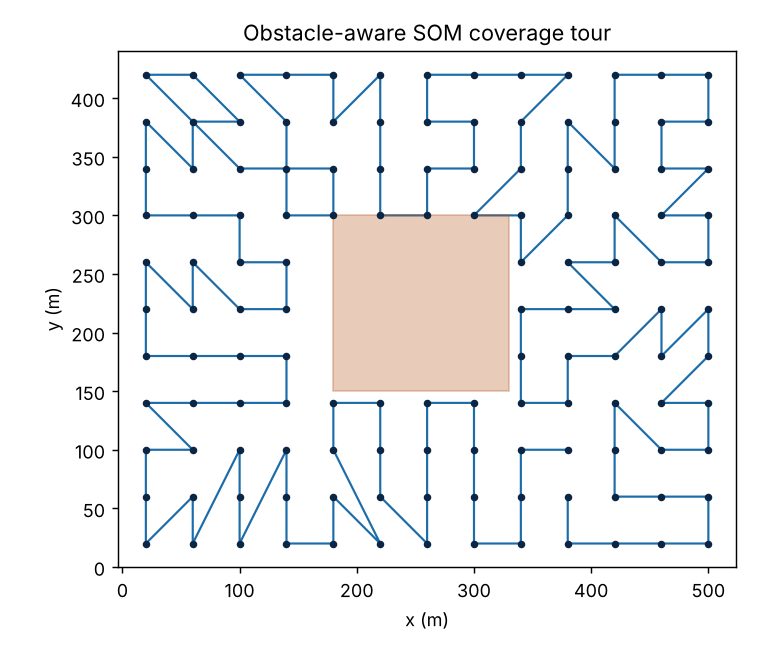
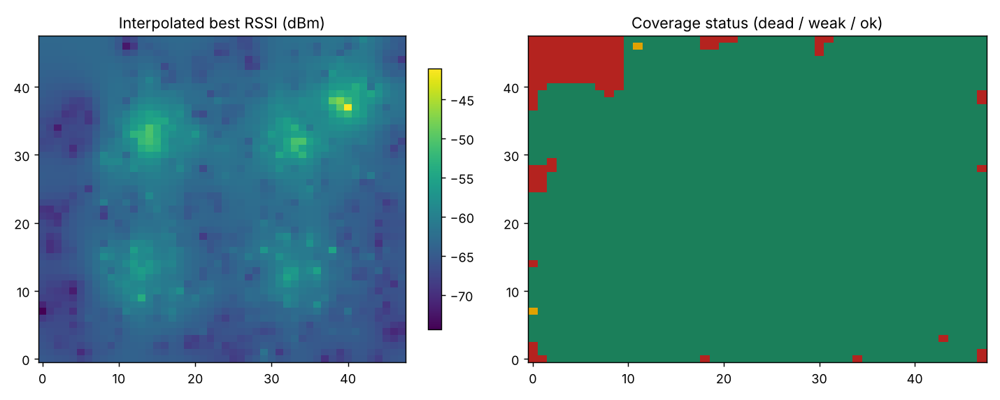

<div align="center">

# 🛰️ UAV Dead-Zone & Rogue-AP Detection

### Deadzone Detection Based on Packet Sniffing using UAV

A drone-borne Wi-Fi survey toolkit that plans an **obstacle-aware coverage path**,
passively **sniffs 802.11 traffic** along it, and turns the result into a
**wireless dead-zone heatmap** and a **rogue access-point report**.

[](https://www.python.org/)
[](#-testing)
[](LICENSE)
[](#-design-highlights)
[](#-real-capture-on-a-raspberry-pi)

</div>

> **About.** This repository is the engineering companion to the B.Tech internship
> report *“Deadzone Detection Based on Packet Sniffing using UAV”*, carried out at
> **Research Centre Imarat (RCI), DRDO, Hyderabad**. It implements the full
> pipeline as a tested, documented Python package: obstacle-aware coverage
> planning, passive 802.11 capture (Scapy), RF-heatmap dead-zone detection, and
> WPA3-aware rogue access-point classification. The full report PDF lives in
> [`report/`](report/).

---

## ✨ What it does

| Stage | Module | Output |
|------|--------|--------|
| 🗺️ **Plan** a complete-coverage flight path over a region, routing around obstacles | [`planner.py`](src/uav_sniffer/planner.py) | Ordered waypoint tour |
| 📡 **Sniff** 802.11 beacon/probe frames (passively) along the path | [`sniffer.py`](src/uav_sniffer/sniffer.py) | Geo-tagged `Observation`s |
| 🔥 **Map** signal strength and find dead/weak zones | [`deadzone.py`](src/uav_sniffer/deadzone.py) | RSSI heatmap + coverage status |
| 🛡️ **Detect** rogue / evil-twin access points | [`rogue_ap.py`](src/uav_sniffer/rogue_ap.py) | Classified AP inventory |

### Example output (synthetic survey, no hardware needed)

<div align="center">

**Coverage path planning** &nbsp;·&nbsp; **RF dead-zone heatmap**


&nbsp;


</div>

```text
$ uav-sniffer demo
observations  : 2840
dead cells    :   4.9%
weak cells    :   0.1%

access points:
  ⚠ ROGUE    de:ad:be:ef:00:01  ssid='campus-wifi'  ch=1   sec=OPEN       rssi=-40.8
             ↳ H1: BSSID/OUI not on managed allow-list
             ↳ H2: unlisted BSSID advertising trusted SSID 'campus-wifi'
             ↳ H3: security downgrade (OPEN < expected WPA2/WPA3)
  ✓ secured  a4:2b:8c:11:22:33  ssid='campus-wifi'  ch=36  sec=WPA2/WPA3  rssi=-46.9
  ✓ secured  ...
```

---

## 🧠 How it works

```
                 ┌──────────────────────────────────────────────────────┐
                 │                    GROUND / LAPTOP                     │
                 │   uav-sniffer CLI  →  heatmap.png · report.json        │
                 └───────────────▲───────────────────────┬───────────────┘
                                 │ observations           │ coverage tour
                                 │ (RSSI, BSSID, GPS)      ▼
   ┌───────────────┐    ┌────────┴─────────┐    ┌──────────────────────┐
   │  CoveragePlanner │  │     Sniffer      │    │  DeadZoneMapper +    │
   │  SOM + obstacle  │─▶│  Scapy monitor / │───▶│  RogueAPDetector     │
   │  culling (grid)  │  │  PCAP / synthetic│    │  heatmap + AP labels │
   └───────────────┘    └──────────────────┘    └──────────────────────┘
          ▲                      ▲
          │ reception geometry   │ passive 802.11 beacons/probes
          │ (spacing = 2·r)      │ captured from the UAV in flight
```

1. **Coverage Path Planning.** The region is tiled with sensing nodes spaced at
   the receiver's reception **diameter** `2r`. Nodes inside obstacle polygons are
   culled (ray-casting point-in-polygon). A **Self-Organising Map**, *seeded by a
   boustrophedon sweep*, orders the survivors into a short tour.
2. **Passive Capture.** Along the tour the UAV's monitor-mode radio captures
   beacon/probe frames → `(lat, lon, bssid, ssid, channel, rssi, security)`.
3. **Dead-Zone Mapping.** Best-RSSI-per-point samples are interpolated (IDW) onto
   a grid; cells below the usability floor (default `-82 dBm`) are **dead**,
   fragile cells are **weak**.
4. **Rogue Detection.** Each BSSID is checked against an allow-list plus four
   heuristics (unknown OUI, evil-twin SSID, **security downgrade**, hidden node)
   that stay valid under **WPA3 / 802.11w** and MAC randomization.

---

## 🚀 Quick start

```bash
git clone https://github.com/your-username/uav-deadzone-detection.git
cd uav-deadzone-detection

python -m venv .venv && source .venv/bin/activate
pip install -e ".[viz]"          # core + matplotlib; add ".[capture]" for Scapy

# 1) Run the full offline demo (no radio required) → writes ./out/*
uav-sniffer demo --out out

# 2) Plan a coverage tour over a bounding box with an obstacle (metres)
uav-sniffer plan --box 17.470 78.360 17.474 78.365 --radius 20 \
                 --obstacle "180,150;330,150;330,300;180,300" --out out

# 3) Analyse a real capture file
uav-sniffer analyse --pcap survey.pcap --box 17.470 78.360 17.474 78.365 \
                    --allow a4:2b:8c:11:22:33 --out out
```

You can also drive it from Python:

```python
from uav_sniffer import CoveragePlanner, DeadZoneMapper, RogueAPDetector
from uav_sniffer.models import GeoBox
from uav_sniffer.rogue_ap import AllowList
from uav_sniffer import sniffer

area = GeoBox(17.470, 78.360, 17.474, 78.365)
plan = CoveragePlanner(area, reception_radius_m=20).plan()

obs  = sniffer.synthetic()                       # or sniffer.from_pcap("survey.pcap")
heat = DeadZoneMapper(area).build(obs)
aps  = RogueAPDetector(AllowList(oui_prefixes={"a4:2b:8c"})).classify(obs)

print(f"{heat.dead_fraction:.0%} dead; {sum(a.classification=='rogue' for a in aps)} rogue APs")
```

---

## 📻 Real capture on a Raspberry Pi

> Only capture on networks **you own or are explicitly authorised to test** — see
> [SECURITY.md](SECURITY.md).

1. **Hardware:** Raspberry Pi 5 (or 4) + an external monitor-mode adapter
   (e.g. MediaTek MT7612U for 5 GHz, or a Wi-Fi 6/6E adapter for 6 GHz) + a GPS
   module for geo-tagging.
2. **Enable monitor mode** and capture to PCAP:
   ```bash
   sudo airmon-ng start wlan1
   sudo tcpdump -ni wlan1mon -s 0 -w survey.pcap     # or capture live with Scapy
   ```
3. **Analyse** the capture with `uav-sniffer analyse` (above). Supply a GPS
   callback to `sniffer.from_pcap(path, position=...)` so each frame is placed on
   the map.

On current Raspberry Pi OS the management hotspot is configured with **RaspAP**
or `nmcli device wifi hotspot`, which handles the interface address, DHCP/DNS and
NAT in one managed step.

---

## 🔭 Design highlights

| Subsystem | Approach |
|-----------|----------|
| **Capture stack** | `Scapy` / Kismet / `tshark`; passive management-frame capture → PCAPNG + JSON |
| **Compute** | Raspberry Pi 5 / 4 companion computer, NetworkManager |
| **Spectrum** | 2.4 / 5 / 6 GHz (Wi-Fi 6E); extensible to Wi-Fi 7 (802.11be) |
| **Dead-zone model** | RSSI/SNR **heatmap** (IDW/RBF) with both **dead** and **weak** contours |
| **Rogue detection** | allow-list + evil-twin + **security-capability mismatch** + hidden-node, robust to WPA3 / 802.11w and MAC randomization |
| **Path planning** | **boustrophedon-seeded SOM** — a refiner, not a cold-start optimiser |
| **Obstacle handling** | ray-casting point-in-polygon node culling before planning |
| **Flight / compliance** | PX4 / ArduPilot, Remote ID, DGCA Digital Sky, geofencing |
| **Privacy** | salted-hash device identifiers, randomization-aware, least-data retention |

---

## 🗂️ Project structure

```
uav-deadzone-detection/
├── report/                  # LaTeX source + compiled PDF of the full report
│   ├── main.tex  preamble.tex  frontmatter.tex  ch1-3.tex  ch4-8.tex  ch9-end.tex
│   └── main.pdf
├── src/uav_sniffer/
│   ├── planner.py           # coverage path planning (SOM + obstacle culling)
│   ├── sniffer.py           # Scapy / PCAP / synthetic capture
│   ├── deadzone.py          # RSSI heatmap + dead/weak-zone extraction
│   ├── rogue_ap.py          # rogue / evil-twin detection
│   ├── models.py            # Observation, AccessPoint, GeoBox, Obstacle
│   └── cli.py               # `uav-sniffer` command-line interface
├── examples/run_demo.py     # end-to-end offline demo → figures + JSON
├── tests/                   # pytest suite (planner + detection)
├── docs/figures/            # README images
├── pyproject.toml  requirements.txt
├── SECURITY.md  LICENSE  .gitignore
└── README.md
```

---

## 🧪 Testing

```bash
pip install -e ".[dev]"
pytest -q          # 9 tests: grid spacing, obstacle culling, SOM tour,
                   #          dead-zone carving, evil-twin & downgrade detection
```

---

## ⚖️ Legal & ethical use

This tool performs **passive** wireless surveying for **authorised** network
assurance and security testing only. It never associates, injects, deauthenticates
or decodes payloads, and it hashes device identifiers by default. Intercepting
third-party traffic is illegal in most jurisdictions. Drone flights must comply
with local aviation rules (FAA **Remote ID**, India **DGCA Drone Rules 2021** /
Digital Sky) and geofencing. Read [SECURITY.md](SECURITY.md) before any field use.

---

## 🧩 Extending the system

The architecture leaves clean seams for further work:

- Live GPS/MAVLink bridge so waypoints and captures share one clock
- Reinforcement-learning and OR-Tools coverage-planning baselines
- RF fingerprinting + beacon-timing features for rogue detection
- MQTT streaming pipeline → live web dashboard
- On-board inference to pre-filter frames before they leave the UAV
- Kriging interpolation and GeoTIFF/KML heatmap export

---

## 🙏 Acknowledgements & references

- **Dr. Santanu Chatterjee** (Scientist, DRDO-RCI) and **Prof. Thammi Reddy**
  (HoD CSE, GITAM) — project guidance.
- Coverage-path-planning literature: Zelinsky *et al.* (1993), Yun *et al.*
  (2010), Jimenez *et al.* (2007).
- [Scapy](https://scapy.net) · prior Raspberry-Pi sniffer work by
  [adityashrm21](https://github.com/adityashrm21/RaspberryPi-Packet-Sniffer).

Full bibliography is in the [report PDF](report/main.pdf).

## 📄 License

[MIT](LICENSE) © Raja Raghu Ram Pydi.
